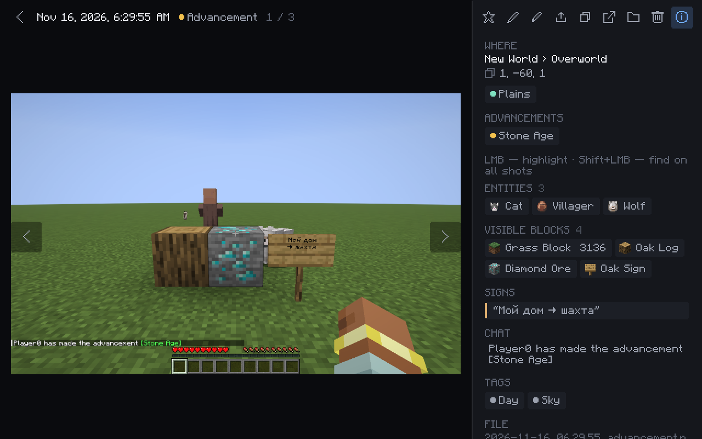
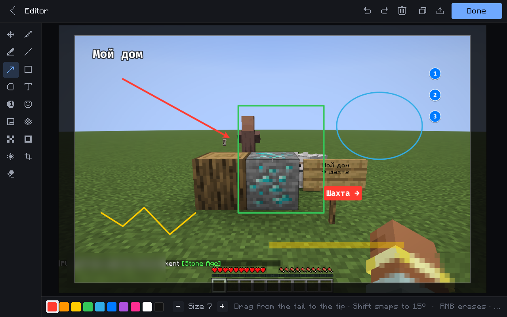

# Smart Screenshots

A client-side Fabric mod for Minecraft that sorts your screenshots by server and world, takes some on its own,
remembers what was on each one, and gives you an in-game gallery to find, mark up and share them.

English and Russian UI. Public domain ([Unlicense](LICENSE)): do whatever you want with it.



## Features

**Sorted on disk.** Shots go to `screenshots/<singleplayer|multiplayer|realms>/<world or server>/<sub-world>/`.
Servers with several worlds behind one address (lobby, survival, resource world...) are told apart by the world
seed, so each gets its own folder. Folders can be renamed from the gallery.

**Shots it takes for you**
- Advancements: a shot a moment after you get one.
- First meetings: one shot the first time you ever see another player, once they are properly in frame.
  The list of met players is shared by every world, server and launcher instance. Places such as server
  lobbies can be excluded (the PepeLand lobby is excluded out of the box).
- Auto shots on round wall-clock times (every 10 minutes: 19:10, 19:20...), hidden from the gallery by default.

**Knows what's on the shot.** Blocks, mobs, named mobs, players (with their tab-list styling), dropped items,
sign text, visible chat lines, biome, coordinates, time of day and weather are saved next to each shot.

**Gallery** (`G` or the button in the pause menu)
- Search everything at once or by field: `player:Notch`, `block:diamond_ore`, `mob:wolf`, `sign:"welcome"`,
  `chat:gg`, `biome:desert`, `type:advancement`, `date:2026-11`, `fav`, `-word`, `/regex/`. Russian keywords
  work too (`игрок:`, `блок:`, `моб:`...).
- Click a block, mob or player in the info panel (or right on the image) to outline it on the shot.
- Long lists in the info panel are folded to two rows with an "N more" button.
- Shots from other Prism Launcher instances show up in their own section.
- Players screen: how many players you've met in total, and who appears on your shots most and least often.

**Editor** (`E` in the viewer): pen, highlighter, line, arrow, rectangle, ellipse, text, numbered markers, blur,
pixelate, spotlight, crop, stickers (items, mobs, player heads), captions and color filters. The original is
kept, so every edit can be moved, erased or undone later.



**Sharing.** Copy a shot to the clipboard as an image, or upload it (catbox.moe, Litterbox, 0x0.st or any
ShareX-style custom uploader) and copy the link. Both can happen automatically after F2.

**Xaero's Minimap / World Map** (optional): open the world map at a shot, or add a waypoint where it was taken.

**Archive.** Old shots can be shrunk after a while to save space; favorites and edited shots are left alone.

## Install

Needs Minecraft 26.3, [Fabric Loader](https://fabricmc.net/) 0.20.1+, [Fabric API](https://modrinth.com/mod/fabric-api)
and Java 25. Put the jar from [Releases](https://github.com/Vadyanik/smart-screenshots/releases) into `mods/`.

All settings are in the gallery (gear button). Keys can be changed in Controls → Smart Screenshots.

## Where data lives

| What | Where |
|---|---|
| Screenshots and their metadata (`.smartshots.json`, highlight masks) | `<game dir>/screenshots/` |
| Settings | `<game dir>/config/smartshots.json` |
| Players you have met (shared by all instances) | Linux `~/.local/share/smartshots/`, Windows `%APPDATA%\smartshots\`, macOS `~/Library/Application Support/smartshots/` |

Nothing leaves your computer unless you upload a shot yourself or turn on auto-upload.

## Building

```sh
./gradlew build                 # jar in build/libs/
./gradlew runClientGameTest     # walks through every screen and saves screenshots to build/menu-tour/
```

Requires JDK 25.

## License

Released into the public domain under the [Unlicense](LICENSE).
