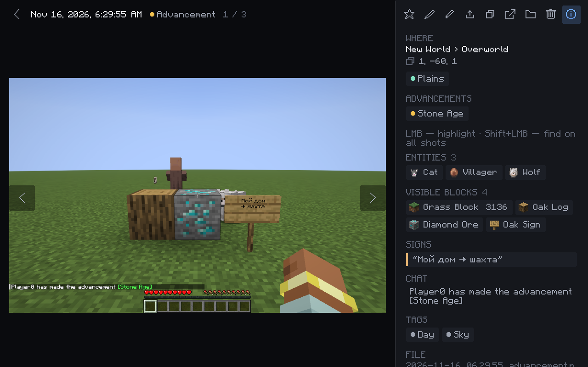
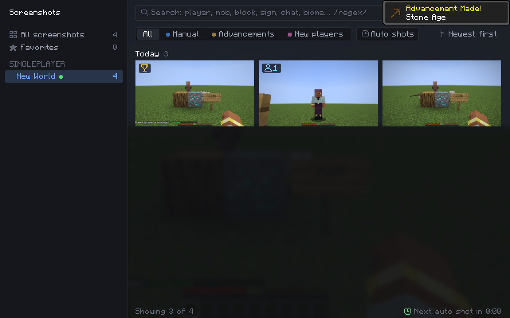
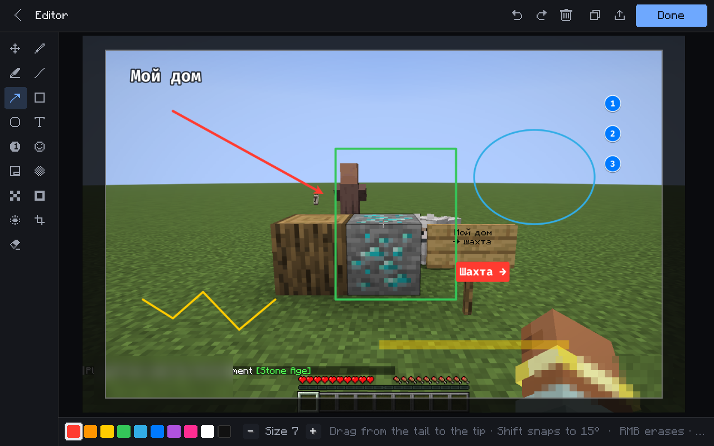
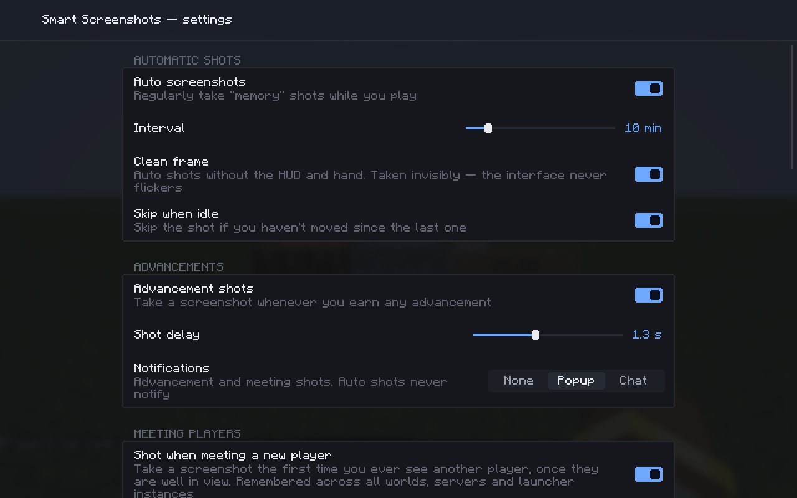

# Smart Screenshots

Your screenshots, sorted by server and world, with an in-game gallery that knows what's on every shot.

## No more one giant folder

Every shot goes into its own folder: `screenshots/multiplayer/<server>/<world>/`. If a server has a lobby, a
survival world and a resource world behind one address, each of them gets its own folder too (they're told
apart by the world seed). Singleplayer worlds and Realms work the same way.

## It takes some shots for you

- **Advancements.** A shot right after you get one, with the advancement still on screen.
- **First meetings.** A shot the first time you ever see another player, once they're properly in frame. The
  list of players you've met is shared by all your worlds, servers and launcher instances. Server lobbies can
  be excluded so you don't get a hundred shots of strangers at spawn.
- **Auto shots.** Optional "memories" on round clock times (19:10, 19:20...). They are hidden in the gallery by
  default, so they don't get in the way.

## It remembers what was on the shot

Blocks, mobs (including name-tagged ones), players with their tab-list colors, items on the ground, sign text,
the chat at that moment, biome, coordinates, time of day and weather are all saved next to the image.

## Gallery

Press **G** (or use the button in the pause menu).

- **Search** any word, or a field: `player:Notch`, `block:diamond_ore`, `mob:wolf`, `sign:"home"`, `chat:gg`,
  `biome:desert`, `type:advancement`, `date:2026-11`, `fav`, `-word`, or a `/regex/`.
- **Highlights.** Click a block, mob, player or sign in the info panel, or right on the picture, and it gets a
  real outline on the shot.
- **Players screen.** How many players you've met in total, and who shows up on your shots most and least.
- Favorites, notes, filters by type, and shots from your other Prism Launcher instances.

## Editor

Press **E** in the viewer. Pen, highlighter, arrows, shapes, text, numbered markers, blur, pixelate, spotlight,
crop, stickers (any item, mob or player head), captions and color filters. The original is kept, so any edit
can be moved, erased or undone later, even after a restart.

## Sharing

Copy a shot to the clipboard as an image (Ctrl+C), or upload it to catbox.moe, Litterbox, 0x0.st or your own
ShareX-style uploader and get the link copied. Both can also happen automatically after F2.

## Xaero's Minimap / World Map

Optional. Open the world map right where a shot was taken, or add a waypoint there with one click.

## Settings

Everything is configured in-game, from the gear button in the gallery.

## Requirements

- Minecraft 26.3, Fabric Loader 0.20.1+, Fabric API, Java 25
- Client-side only, works on any server

The mod is in English and Russian. It sends nothing anywhere unless you upload a shot yourself or turn on
auto-upload.

Source code: [github.com/Vadyanik/smart-screenshots](https://github.com/Vadyanik/smart-screenshots). Public
domain (Unlicense), so do whatever you want with it.
