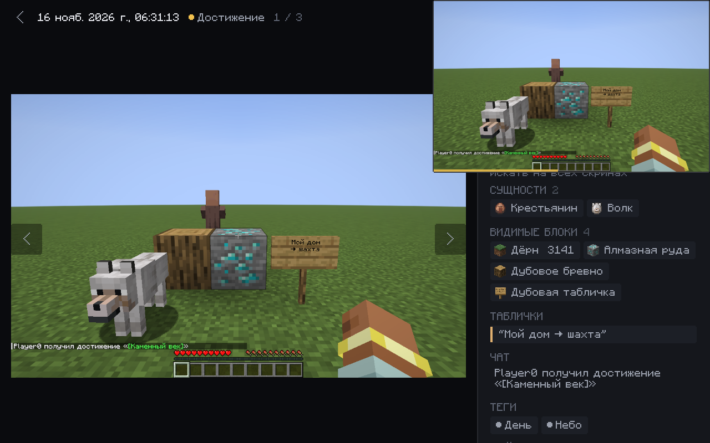
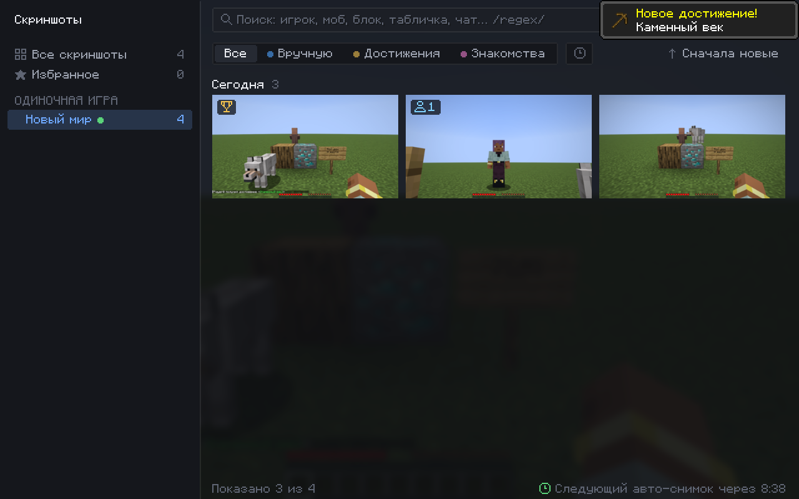
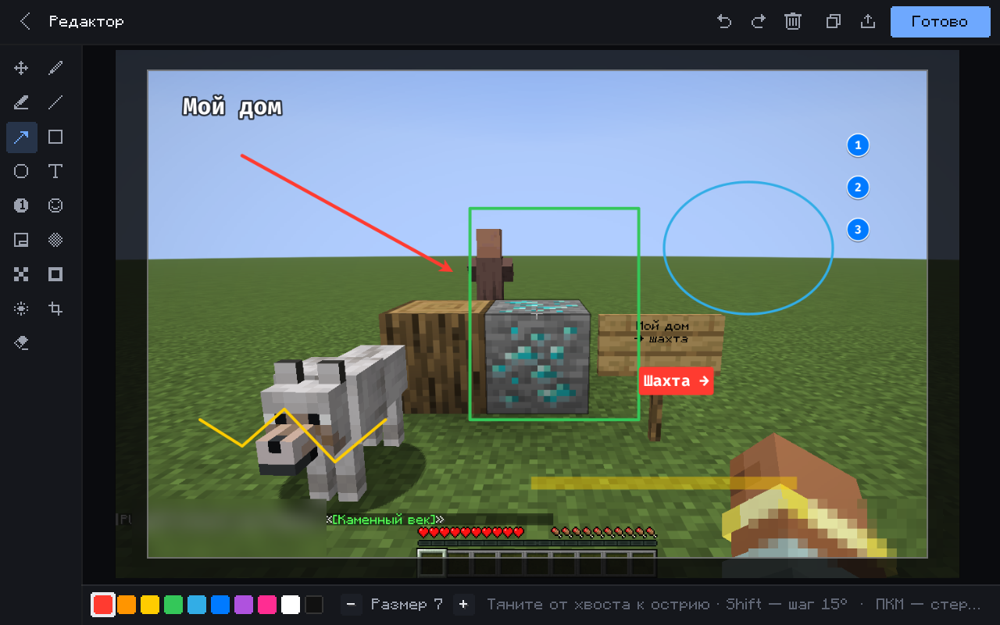
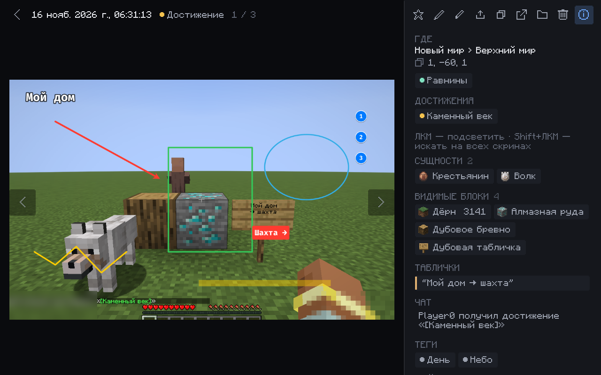
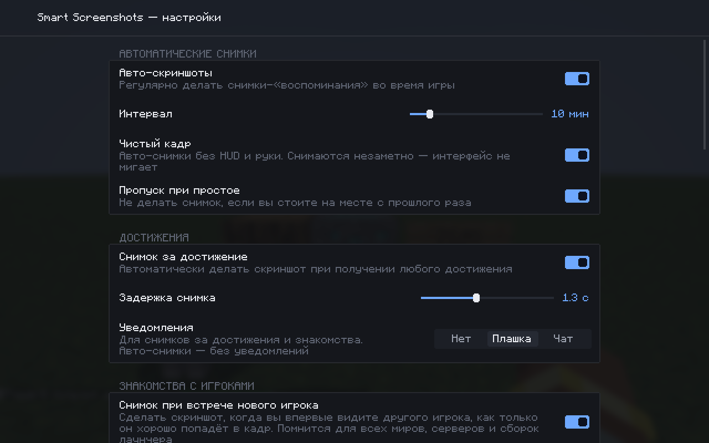

# Smart Screenshots

Скриншоты, разложенные по серверам и мирам, и галерея прямо в игре, которая знает, что есть на каждом снимке.

## Больше никакой одной огромной папки

Каждый снимок попадает в свою папку: `screenshots/multiplayer/<сервер>/<мир>/`. Если у сервера за одним
адресом лобби, выживание и мир ресурсов, у каждого из них тоже будет своя папка (их мод различает по сиду
мира). Одиночные миры и Realms раскладываются так же.

## Мод сам делает снимки

- **Достижения.** Скриншот сразу после получения, пока достижение ещё на экране.
- **Знакомства.** Скриншот, когда ты впервые видишь другого игрока и он нормально попал в кадр. Список
  встреченных игроков общий для всех миров, серверов и сборок лаунчера. Лобби серверов можно исключить, чтобы
  не получить сотню снимков незнакомцев на спавне.
- **Авто-снимки.** По желанию: «воспоминания» в круглое время (19:10, 19:20...). В галерее они по умолчанию
  скрыты и не мешают.

## Мод запоминает, что было на снимке

Блоки, мобы (в том числе с бирками), игроки с цветами ника из TAB, предметы на земле, текст табличек, чат в
этот момент, биом, координаты, время суток и погода сохраняются рядом с картинкой.

## Галерея

Клавиша **G** (или кнопка в меню паузы).

- **Поиск** по любому слову или по полю: `игрок:Notch`, `блок:алмаз`, `моб:волк`, `табличка:"дом"`, `чат:gg`,
  `биом:пустыня`, `тип:достижение`, `дата:14.11`, `избранное`, `-слово` или `/регулярка/`. Английские
  ключи (`player:`, `block:`...) тоже работают.
- **Подсветка.** Кликни по блоку, мобу, игроку или табличке в панели «Инфо» или прямо на картинке, и на
  снимке появится точный контур.
- **Экран «Игроки».** Сколько всего игроков ты встретил и кто чаще и реже всех попадает на твои скриншоты.
- Избранное, заметки, фильтры по типу и снимки из других сборок Prism Launcher.

## Редактор

Клавиша **E** в просмотре. Карандаш, маркер, стрелки, фигуры, текст, нумерованные метки, размытие, пикселизация,
прожектор, обрезка, стикеры (любой предмет, моб или голова игрока), подписи и цветовые фильтры. Оригинал
сохраняется, поэтому любую правку можно сдвинуть, стереть или отменить потом, даже после перезапуска.

## Поделиться

Скопировать снимок в буфер обмена как картинку (Ctrl+C) или загрузить на catbox.moe, Litterbox, 0x0.st или свой
сервис в стиле ShareX, и ссылка сразу скопируется. Можно включить, чтобы это происходило само после F2.

## Карта Xaero

По желанию. Открыть карту мира там, где сделан снимок, или одной кнопкой поставить туда метку.

## Настройки

Всё настраивается в игре, кнопкой-шестерёнкой в галерее.

## Требования

- Minecraft 26.3, Fabric Loader 0.20.1+, Fabric API, Java 25
- Только клиент, работает на любом сервере

Мод на русском и английском. Он ничего никуда не отправляет, пока ты сам не загрузишь снимок или не включишь
автозагрузку.

Исходный код: [github.com/Vadyanik/smart-screenshots](https://github.com/Vadyanik/smart-screenshots).
Общественное достояние (Unlicense): делай с ним что хочешь.
